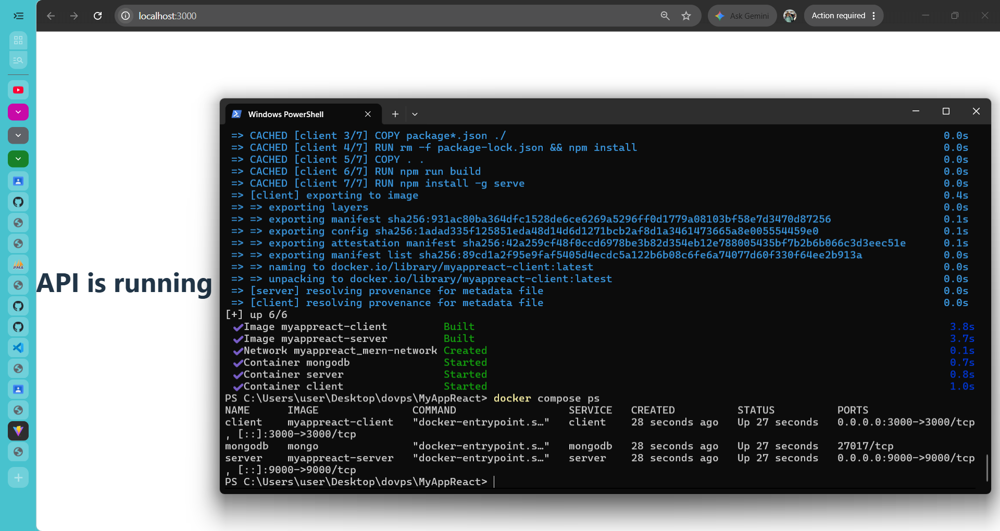
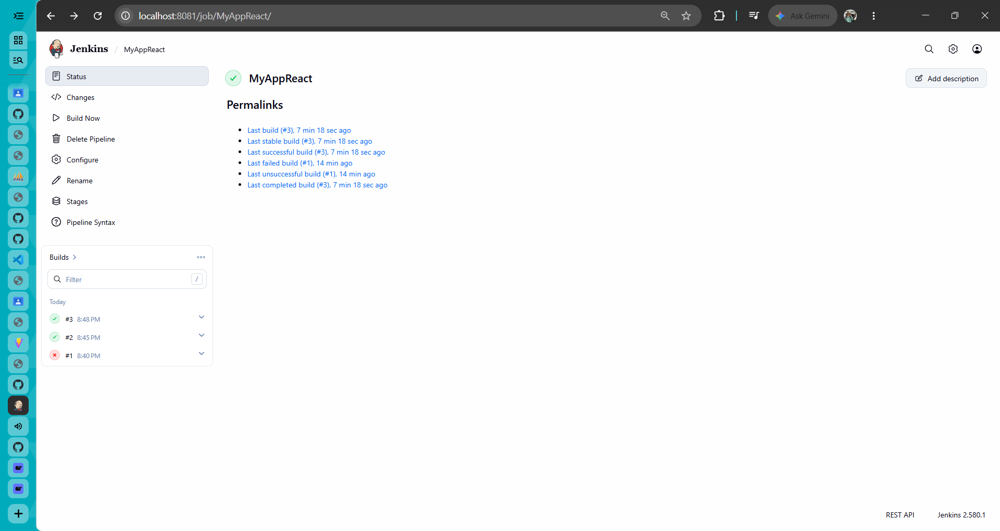
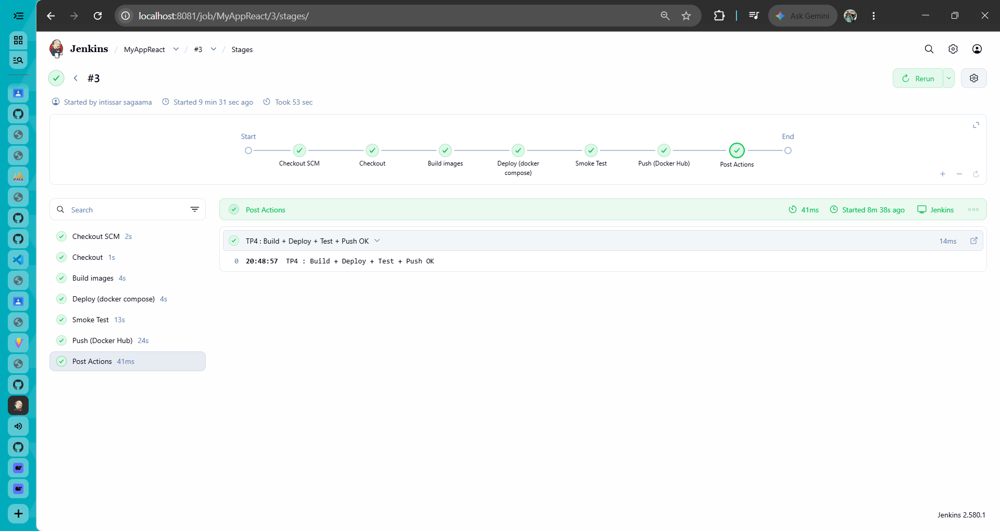
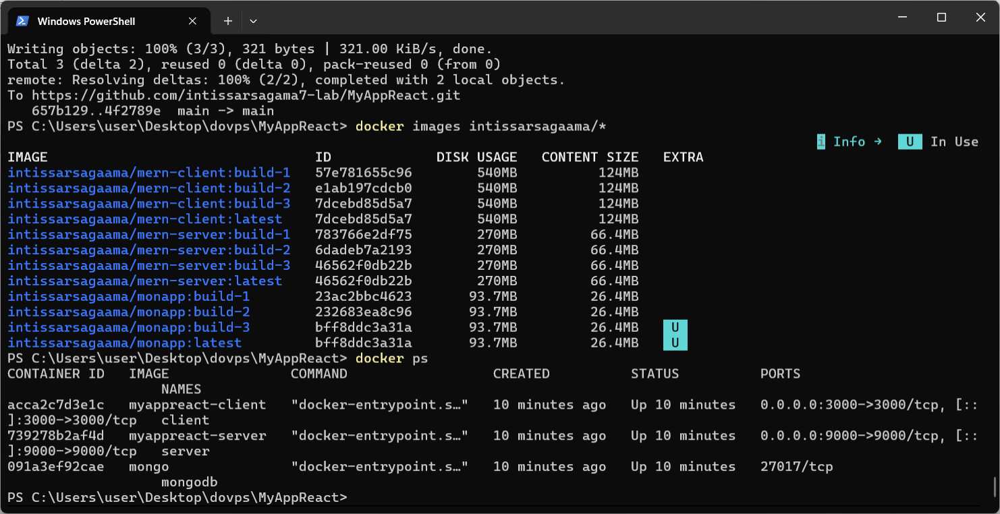
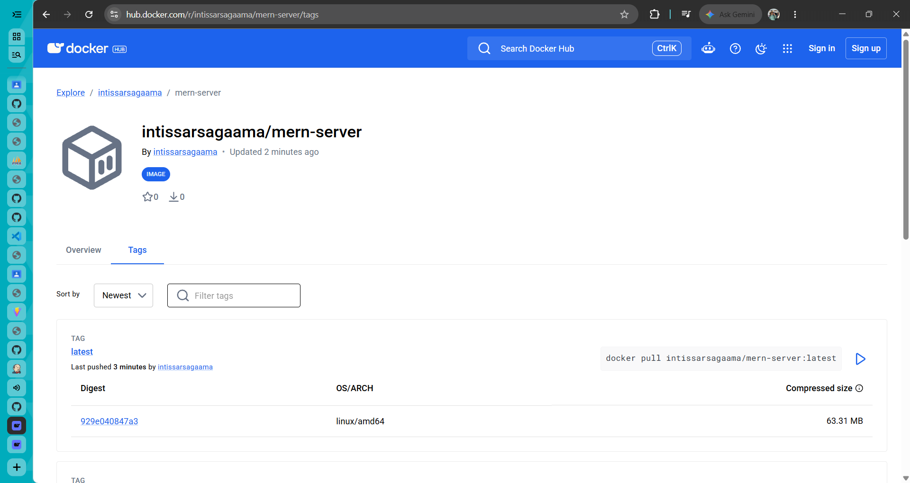
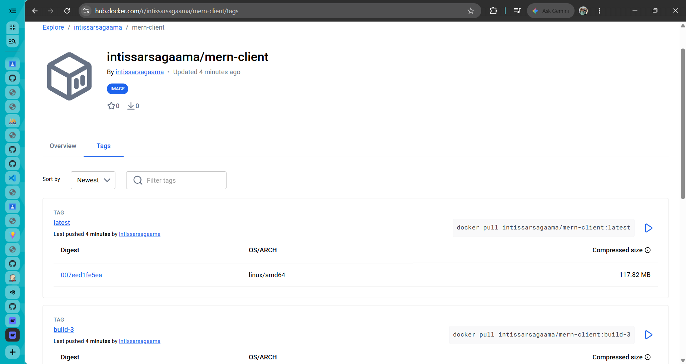

# TP4 – Docker et Docker Compose

## 1. Cloner le projet
```bash
git clone https://github.com/wiem-kb/MyAppReact.git
cd MyAppReact
```
Le projet contient deux dossiers : `client` (application React) et `server` (API Express).

## 2. Créer les Dockerfiles

### a. Serveur (Express) – `server/Dockerfile`
```dockerfile
FROM node:lts-alpine
WORKDIR /app
COPY package*.json ./
RUN npm install
COPY . .
EXPOSE 9000
CMD ["npm", "start"]
```
```bash
docker build -t mern-server ./server
```

### b. Client (React) – `client/Dockerfile`
```dockerfile
FROM node:lts-alpine
WORKDIR /app
COPY package*.json ./
RUN rm -f package-lock.json && npm install
COPY . .
RUN npm run build
RUN npm install -g serve
EXPOSE 3000
CMD ["serve", "-s", "dist", "-l", "3000"]
```
```bash
docker build -t mern-client ./client
```

## 3. Créer un réseau Docker
```bash
docker network create mern-network
```

## 4. Exécuter MongoDB dans un conteneur
```bash
docker run -d --name mongodb --network mern-network mongo
```

## 5. Exécuter les conteneurs du serveur et du client
```bash
docker run -d --name server --network mern-network -p 9000:9000 mern-server
docker run -d --name client --network mern-network -p 3000:3000 mern-client
```

## 6. Docker Compose – `docker-compose.yml`
```yaml
services:
  mongodb:
    image: mongo
    container_name: mongodb
    networks:
      - mern-network

  server:
    build: ./server
    container_name: server
    ports:
      - "9000:9000"
    environment:
      - MONGO_URI=mongodb://mongodb:27017/mern
    depends_on:
      - mongodb
    networks:
      - mern-network

  client:
    build: ./client
    container_name: client
    ports:
      - "3000:3000"
    depends_on:
      - server
    networks:
      - mern-network

networks:
  mern-network:
    driver: bridge
```
```bash
docker compose up --build
```

## Résultat
Les trois conteneurs (`mongodb`, `server`, `client`) sont démarrés par Docker Compose.

### API – http://localhost:9000/api/health


### Client React – http://localhost:3000


## 7. Pipeline Jenkins – `Jenkinsfile`
Le pipeline automatise : Checkout → Build des images → Déploiement (docker compose) → Smoke test → Push sur Docker Hub.

- **Build images** : construction de `mern-server` et `mern-client` avec deux tags (`build-N` et `latest`).
- **Deploy** : suppression des anciens conteneurs puis `docker compose up -d --build`.
- **Smoke test** : vérification de l'API (`/api/health` doit renvoyer « API is running ») et du client (`HTTP 200 OK`).
- **Push** : connexion à Docker Hub avec le credential Jenkins `dockerhub-creds`, puis push des images.

### Job Jenkins


### Étapes du pipeline (build #3)


### Images et conteneurs


### Docker Hub




## Liens
- Projet GitHub : https://github.com/intissarsagama7-lab/MyAppReact
- Image serveur : https://hub.docker.com/r/intissarsagaama/mern-server
- Image client : https://hub.docker.com/r/intissarsagaama/mern-client
